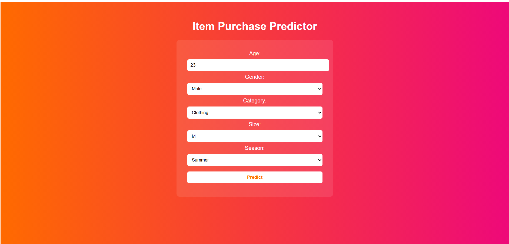

# Shopping Trends: Item Purchase Predictor

An end-to-end data science and machine-learning project that predicts which item a customer may purchase from shopping-trend data. This React frontend collects customer details and sends them to a Flask API backed by a scikit-learn model.

## Screenshot



## Features

- Collects a customer's age, gender, product category, size, and season.
- Sends the form data to the prediction API and displays the predicted item.
- Shows a message when the prediction request fails.

## Machine-learning workflow

The project uses `backend/shopping_trends.csv` to train a multi-class classifier for the `Item Purchased` target:

1. Uses age, gender, category, size, and season as input features.
2. One-hot encodes the categorical features and passes age through as a numeric feature.
3. Splits the data into training and test sets (80/20).
4. Trains a scikit-learn pipeline with a 100-tree `RandomForestClassifier` and reports test accuracy.
5. Serves predictions through a Flask `/predict` endpoint, which loads `backend/item_predictor_model.pkl`.

The model training and API scripts, dataset, and model files are grouped in the repository's `backend/` folder. This README covers the frontend and explains how to start both parts of the app.

## Requirements

- Node.js and npm
- Python and pip
- The prediction backend running at `http://localhost:5000`

The backend is separate from this frontend. The app sends a `POST` request to `/predict` with JSON fields `Age`, `Gender`, `Category`, `Size`, and `Season`. A successful response contains a `predicted_item` field.

## Getting started

### Start the backend

```bash
cd backend
python -m pip install -r requirements.txt
python app.py
```

The API starts at `http://localhost:5000`. Keep this terminal running.

### Start the frontend

In a second terminal, from the repository root:

```bash
cd frontend/item-predictor
npm install
npm run dev
```

Open the local URL printed by Vite in your browser. The backend must be running to receive predictions.

### Train and evaluate the model

From the repository root, install the backend dependencies first, then run:

```bash
python backend/model.py
```

This trains and evaluates the pipeline using the CSV in `backend/`. The current training script prints test accuracy and an example prediction; it does not save or replace `backend/item_predictor_model.pkl`, which is the model file loaded by the API.

## Available commands

Run these commands from `frontend/item-predictor`:

| Command | Description |
| --- | --- |
| `npm run dev` | Start the Vite development server. |
| `npm run build` | Create a production build in `dist/`. |
| `npm run preview` | Preview the production build locally. Run `npm run build` first. |
| `npm run lint` | Check the project with ESLint. |

## Form options

| Field | Options |
| --- | --- |
| Age | Required numeric value |
| Gender | Male, Female |
| Category | Clothing, Footwear, Outerwear |
| Size | S, M, L, XL |
| Season | Summer, Winter, Spring, Fall |